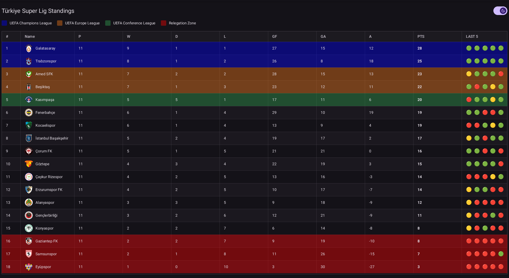

# League

A Turkish Süper Lig standings table, built with `goi` from a JSON file and a
`.goi` design.



## What it shows

The whole Turkish Süper Lig table: position, team badge and name, played, won,
drawn, lost, goals for, goals against, average and points, plus each team's last
five results as coloured dots. Rows carry their competition zone as a band of
colour, matching the legend above the table:

- blue — UEFA Champions League
- orange — UEFA Europa League
- green — UEFA Conference League
- red — relegation

The table scrolls inside a fixed-height area with a sticky header, so the column
names stay put while the rows move. Columns marked `sortable` sort when clicked.

A switch in the top right follows the desktop's light or dark scheme and flips it
on demand.

## How it works

The data lives in `data/super_lig.json`, one object per team. `main.go` reads it
and hands the slice to the design in `Bind`:

```go
ui.SetData(w, "teams", teams)
```

The design declares that slice as a bridge type and repeats a row for each entry:

```goi
bridge {
	teams []Team
}

Table {
	for i, team := range bridge.teams {
		TableRow {
			background: conditional {
				"#0000ff66": i == 0 || i == 1
				"#fa7b1766": i == 2 || i == 3
				"#34a85366": i == 4
				"#ff000066": i == 15 || i == 16 || i == 17
			}
			/* … one TableCell per column … */
		}
	}
}
```

There is no scripting in a `.goi` file, so everything that reads or computes a
value — `formatf("%d", team.points)`, `team.goalsFor - team.goalsAgainst`, the
`conditional` that picks a W/D/L dot — is an expression. The Go side only parses
the JSON and swaps the theme.

`ui.SetData` rebuilds the rows, which is what makes the table follow a new season
without touching the design. A hot reload re-runs `Bind`, so the data stays
correct while the layout is edited.

## Run it

The example loads `league/ui/league.goi` and `league/data/super_lig.json` by
relative path, so run it from the `examples` checkout:

```sh
make league
```

or:

```sh
go run -ldflags=-linkmode=internal ./league
```

Badges are fetched from the network; a team whose badge cannot be downloaded
keeps its row and shows an empty badge box instead of failing.

## What it demonstrates

- a bridge slice and `ui.SetData` driving `for … range` rows
- `conditional { … }` as a value, not a statement
- `Table` with sorting, striping, a sticky header and a scroll area
- `app.systemMode` / `app.mode` for a light/dark switch that starts from the
  desktop preference
- remote images inside table cells, cached across hot reloads
